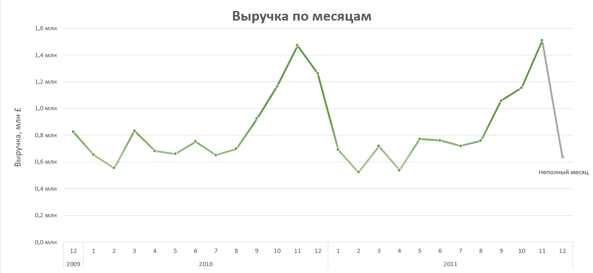
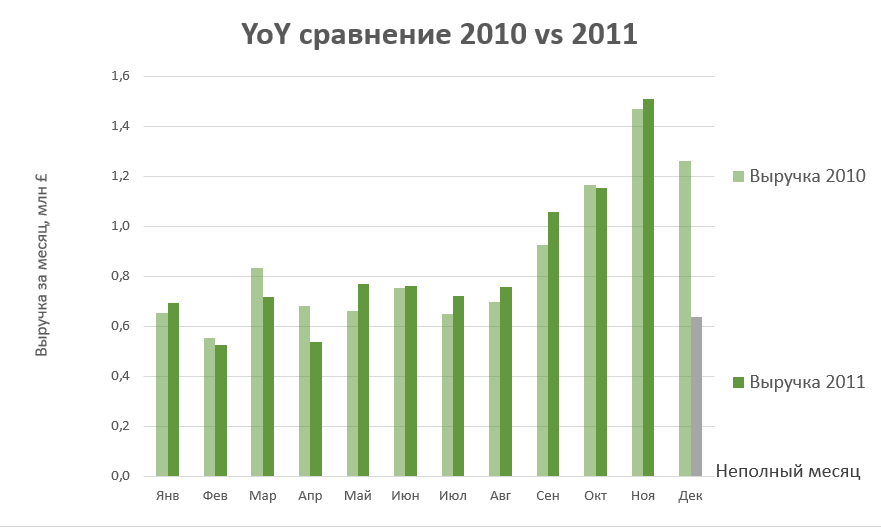
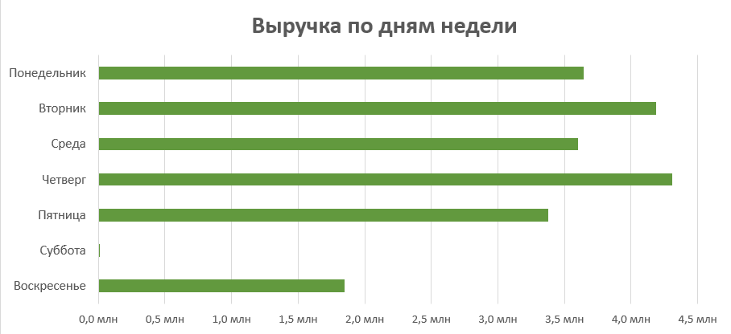
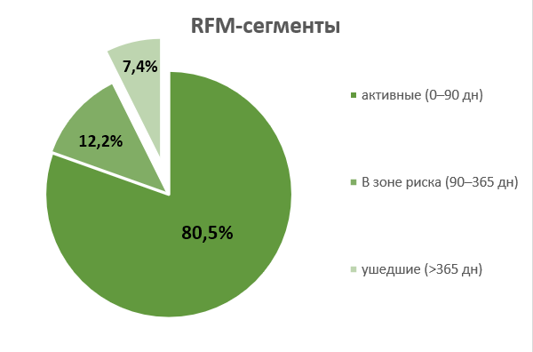

# 📊 Online Retail II: выручка и RFM-сегментация (2009–2011)
**О проекте:** анализ транзакционных данных интернет-магазина для выявления сезонных трендов, оценки динамики выручки год к году и сегментации клиентов по RFM. Данные агрегированы по месяцам и дням недели, учтены возвраты и нулевые транзакции.

**Автор:** Никифорова Полина
**Дата:** 21.11.2026
**Статус:** Завершено

**Что внутри репозитория:**
- `analysis.sql` — все запросы для расчётов (очистка, агрегация, RFM) с комментариями.
- Графики: выручка по месяцам, YoY-сравнение, выручка по дням недели, RFM-сегментация.
- `README.md` — выводы и ограничения данных.

**Ограничения данных:** декабрь 2011 — неполный месяц (данные до 09.12.2011), поэтому выручка в конце периода — артефакт, а не реальный спад.

## Ключевые выводы

- **Общая выручка за период:** ~20,97 млн £.
- **Сезонность:** выручка растёт к концу каждого года — два рождественских пика (ноябрь 2010 и ноябрь 2011, ~1,5 млн £ в месяц).
- **Динамика год к году:** в большинстве месяцев 2011 обгоняет 2010, особенно в осенний сезон (сентябрь–ноябрь). Декабрь 2011 — неполный месяц (данные до 9 декабря), в честном сравнении не участвует.
- **Дни недели:** основная выручка — в будни, пик в четверг (~4,3 млн суммарно за 2009–2011). Суббота практически не приносит выручки; воскресенья работают, но с самым низким средним чеком (~382 £).
- **RFM-сегментация:** активные клиенты (последняя покупка 0–90 дней) дают **80,5%** выручки; сегмент «в зоне риска» (90–365 дней) — 12,2%; ушедшие (>365 дней) — 7,4%. Сегмент ушедших выдвинут на круговой диаграмме отдельно: база раздута «мёртвыми» контактами, но их вклад в выручку минимален — потенциал для реактивации.

## Визуализация результатов

### Выручка по месяцам

*Два рождественских пика: ноябрь–декабрь 2010 и ноябрь 2011. Точка декабря 2011 отмечена как неполный месяц (данные обрываются 9 декабря), поэтому «падение» в конце — артефакт выгрузки, а не провал продаж.*

### Сравнение год к году (2010 vs 2011)

*В большинстве месяцев 2011 год обгоняет 2010-й, особенно в осенний сезон. Декабрь 2011 показан серым как неполный.*

### Выручка по дням недели (суммарно за 2009–2011)

*Основная выручка приходится на будни, пик — четверг. Суббота практически не работает.*

### RFM-сегменты по доле выручки

*Активные клиенты дают 80,5% выручки. Сектор ушедших выдвинут для акцента: их вклад минимален при заметной доле в базе.*

## Как воспроизвести анализ
1. **Скачайте данные** — [Online Retail II, UCI Machine Learning Repository](https://archive.ics.uci.edu/dataset/502/online+retail+ii). Исходный CSV весит ~1,5 ГБ, поэтому в репозиторий не включён.
2. **Импортируйте CSV в PostgreSQL** как таблицу `retail_raw` (например, через DBeaver: ПКМ по схеме → Импорт данных). Ожидаемые колонки: `invoice_no`, `invoice_date`, `quantity`, `unit_price`, `customer_id`.
3. **Выполните `analysis.sql`** сверху вниз. Скрипт создаёт представление `retail_new` (очистка возвратов, нулевых цен и заказов без клиента) и возвращает 4 набора данных — по одному на каждый график.
4. **Экспортируйте результаты** в CSV (в DBeaver: ПКМ по результату → Экспорт данных) и постройте графики в Excel:
   - запрос 1 → линейный график «Выручка по месяцам»;
   - запрос 2 → сгруппированные столбцы «YoY 2010 vs 2011»;
   - запрос 3 → горизонтальная гистограмма «Выручка по дням недели»;
   - запрос 4 → круговая диаграмма «RFM-сегменты».
5. **Сохраните графики** как PNG в этом README.

## Источник данных

- **Датасет:** [Online Retail II, UCI Machine Learning Repository](https://archive.ics.uci.edu/dataset/502/online+retail+ii)
- **Период:** декабрь 2009 — декабрь 2011 (декабрь 2011 — неполный, до 9 декабря).
- **Валюта:** фунты стерлингов (£).
- **Обработка:** исключены возвраты (`quantity <= 0`, счета с префиксом `C`), нулевые цены и транзакции без `customer_id`.

## Стек

- **SQL (PostgreSQL)** — очистка, агрегация, RFM-сегментация
- **Excel** — визуализация
- **Git / GitHub** — публикация проекта

